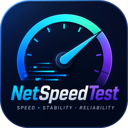
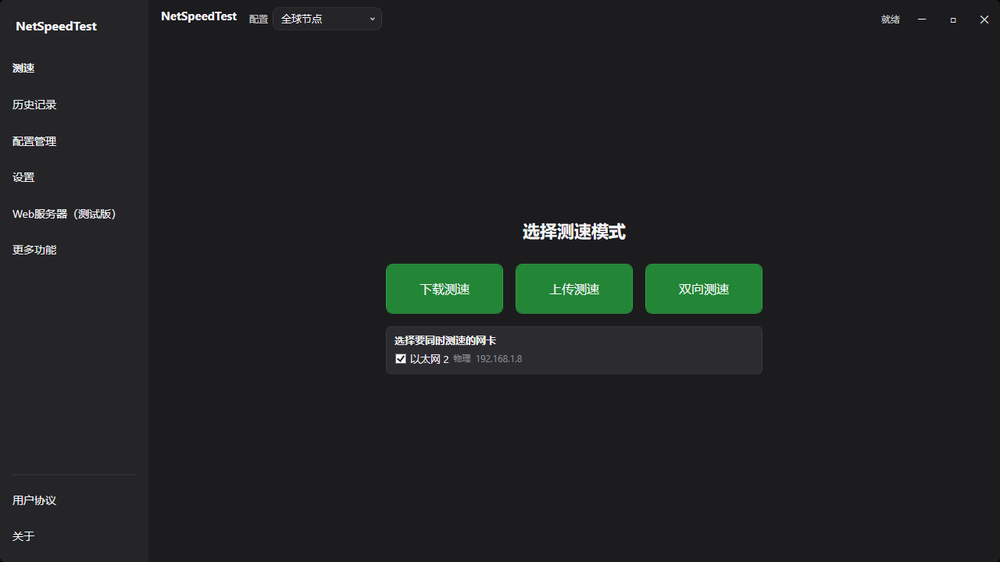

<div align="center">



[中文](README.md) &nbsp;·&nbsp; **English**

# 🚀 NetSpeedTest

**A professional Windows desktop network speed test tool · Open source & free**

[](LICENSE)
[](https://dotnet.microsoft.com)
[](https://github.com/lingyingaojue/NetSpeedTest)
[](https://github.com/lingyingaojue/NetSpeedTest/releases)
[](https://www.deepseek.com)
[](https://github.com/lingyingaojue/NetSpeedTest/stargazers)
[](https://github.com/lingyingaojue/NetSpeedTest/releases)
[](https://github.com/lingyingaojue/NetSpeedTest/commits)
[](https://github.com/lingyingaojue/NetSpeedTest)

</div>

---

<p align="center">
  <b>Smart CDN scheduling</b> &nbsp;·&nbsp;
  <b>Adaptive thread engine</b> &nbsp;·&nbsp;
  <b>Multi-NIC parallel testing</b> &nbsp;·&nbsp;
  <b>Emergency rate compensation</b> &nbsp;·&nbsp;
  <b>Five-tier UDP latency probing</b> &nbsp;·&nbsp;
  <b>18-in-1 Toolbox</b> &nbsp;·&nbsp;
  <b>Remote Web console</b> &nbsp;·&nbsp;
  <b>OTA online update</b>
</p>

---

## 📋 Table of Contents

- [✨ Core Highlights](#-core-highlights)
- [🌐 Web Server & Remote Console](#-web-server--remote-console)
- [🛠️ Network Toolbox](#️-network-toolbox)
- [⌨️ Keyboard Shortcuts](#️-keyboard-shortcuts)
- [⚙️ Tunable Parameters](#️-tunable-parameters)
- [🗂️ Data & Configuration Files](#️-data--configuration-files)
- [🏗️ Tech Stack](#️-tech-stack)
- [🚀 Quick Start](#-quick-start)
- [📥 Download](#-download)
- [📝 Changelog](#-changelog)
- [🤖 How This Project Is Built & AI Collaboration](#-how-this-project-is-built--ai-collaboration)
- [💬 Feedback & Contact](#-feedback--contact)
- [📄 License](#-license)

---



> 🖥️ Main window: dark theme · sidebar navigation · custom-drawn title bar (screenshot captured by a user on a real machine)

---

## ✨ Core Highlights

<table>
<tr>
<td width="50%">

### 🚀 Smart Speed Test Engine
- **Concurrent HTTP GET/POST load** — 128 threads by default, up to 1024 in adaptive mode
- **URL rotation scheduling + health scoring** — the cursor advances after each worker picks a URL; nodes that fail repeatedly enter a cooldown and are automatically down-weighted
- **Adaptive thread ceiling** — ramps up linearly from the starting thread count, so low-end machines are not overwhelmed
- **Emergency rate compensation** — when throughput drops below the peak threshold it adds threads automatically and corrects the result
- **Ramp-up excluded from the average** — the warm-up phase is skipped by "average measurement delay" before averaging, and the degraded period is also subtracted from the denominator
- **Sliding-window smoothing** — de-noises the real-time rate, 3-second window by default
- **Gradual startup** — threads come online in batches at a fixed interval instead of saturating the link instantly

### 🌐 Multi-NIC parallel testing *(v1.4.0)*
- **Test several NICs at once** — each selected adapter binds to its own source IP
- **Virtual adapters are opt-in** — filtered out by default, can be allowed in Settings
- **Per-NIC chart switching** — download/upload charts switch between "combined / single NIC" curves
- **Total speed display** — shows download + upload combined speed in bidirectional mode
- **Per-NIC results in the completion dialog** — rate and error details for every adapter at a glance
- **Default-gateway NIC preferred** — the adapter that owns the default gateway is selected automatically
- **One failing NIC does not sink the rest** — the remaining adapters still complete when one fails

### 📊 NIC-level precision metering
- Differentially derived from `IPv4Statistics`, immune to HTTP overhead
- Real-time up/down Mbps, switching automatically between Kbps / Mbps / Gbps
- **Multi-NIC information card** — 9 details per adapter: IP / gateway / mask / MAC / IPv6 / DNS / DHCP / MTU / status
- Independent per-NIC rate bar with active thread count

</td>
<td width="50%">

### 🌐 Full-chain UDP-first latency probing
- **Unified five-tier fallback**: UDP → ICMP → TCP 443 → HTTPS HEAD → HTTP HEAD
- **WAN / jitter / LAN share one probe chain**, so results stay consistent
- **Internet latency** — single-host UDP polling avoids batch blocking
- **Jitter latency** — sliding-window standard deviation, smoothed in real time
- **Live packet loss monitoring** — 5 packets per batch, ICMP first, automatic UDP recheck when the first round fails
- **Per-NIC metrics** *(v1.4.2)* — LAN latency, internet latency, jitter and packet loss shown for every adapter

### 🎨 Professional interaction design
- **Dual LiveCharts2 line charts**, 200 ms sampling, 500-point sliding window
- **Draggable splitter** between the download and upload charts, **300 ms animated** mode transitions
- **Embedded page architecture** — History / Profiles / Settings / Web Server / More / Protocols / About are all right-hand embedded pages, no popups
- **Custom-drawn title bar + sidebar navigation** — Windows-style window buttons; page switching is disabled while a test runs
- **System tray residency** — context menu / state sync / balloon notifications
- **Dark & light themes** — switch instantly, persisted and restored on startup
- **Bilingual UI** — Simplified Chinese / English with one click, choice persisted
- **GitHub OTA updates** — automatic check on startup plus manual check on the About page; a dialog guides you to the new build

### 🗄️ History & profile management
- SQLite persistence, a dedicated page, one-click clear, a **statistics bar** and CSV export
- 8 built-in CDN nodes, with custom profile import/export (JSON, HBCS-compatible)
- Settings are written with "temp file + atomic replace", so an interrupted write does not lose your configuration
- Multi-NIC export contains the aggregate result, per-NIC details and the BatchId

</td>
</tr>
</table>

> 💡 Starting a test first opens a **preparation dialog**: URL pre-probe + DNS pre-resolution + HEAD warm-up handshake with a linear progress bar; the preparation phase (up to 15 seconds) can still be cancelled.

---

## 🌐 Web Server & Remote Console

A built-in HTTP server (enabled by default, implemented with `HttpListener`, **no extra runtime component to install**) — a phone or another PC on the same subnet can watch and drive the speed test from a browser.

| Capability | Description |
|:-----------|:------------|
| 🖥️ **Web console** | Open `http://<local-IP>:8080` to watch the live rate curves, adapter status and history |
| 🔀 **Automatic port fallback** | If the default port is taken the server probes for the next free port; the actual port is persisted and echoed in the UI |
| ⚙️ **Custom port** | A fixed port can be pinned on the Web Server page (1024 – 65535) |
| 🔐 **Session token protection** | Non-loopback writes must carry the random `X-NST-Token` (256-bit) generated at startup, so a LAN page cannot silently start tests or delete data; loopback access needs no token |
| 🛡️ **LAN access control (ACL)** | An allow-list is derived from the local adapters' subnets: only same-subnet devices are served, anything else gets 403; firewall rules are probed automatically |
| 📄 **Editable page** | The UI lives in `wwwroot\index.html` next to the executable and can be edited without recompiling; release builds also embed a fallback copy |
| 🔒 **Security response headers** | Every response carries `X-Content-Type-Options: nosniff`, `X-Frame-Options: DENY` and `Referrer-Policy: no-referrer` |
| 🚫 **SSRF protection** | Automatic redirects are disabled and every hop is validated (max 3 hops); loopback, private, reserved, CGNAT, multicast and IPv6 private ranges are blocked, and target ports are limited to 80/443 |

### REST API

| Method | Path | Description |
|:-------|:-----|:------------|
| `GET` | `/api/status` | Test state, live rate, current port |
| `GET` | `/api/adapters` | Adapter list and selection state |
| `POST` | `/api/adapters/select` | Choose which adapters take part in the test |
| `GET` | `/api/profiles` | Read the list of speed test profiles |
| `POST` | `/api/profiles` | Create or save a speed test profile |
| `GET` | `/api/history` | Page through history records (`?page=&pageSize=`) |
| `DELETE` | `/api/history` | Clear the history |
| `GET` | `/api/settings` | Read the current test parameters |
| `POST` | `/api/settings` | Write test parameters (concurrent-write safe, atomic persist) |
| `POST` | `/api/test/start` | Start a test (returns 200 only once the running state is real; a repeat call returns 409) |
| `POST` | `/api/test/stop` | Stop a test (also cancels during the preparation phase) |
| `GET` | `/api/server` | Server port, LAN state and adapter-subnet bindings |

> 🧪 Every endpoint:
> - waits on the UI thread with a unified **2-second timeout** and returns 503 instead of hanging; each request also has a **30-second** request-level timeout
> - sanitises error details into category messages, with specifics written to the log only
> - caps request bodies at 256 KB; oversized or malformed payloads return 400

---

## 🛠️ Network Toolbox

**18-in-1 professional network diagnostic tools** built in — daily troubleshooting in a single window:

<table>
<tr>
<td width="50%">

| Tool | Description |
|:-----|:------------|
| 🏓 **Ping** | ICMP connectivity test with a custom target and count, reporting per-packet RTT and TTL |
| 🌐 **DNS Query** | A / AAAA resolution with elapsed time and address family |
| 📡 **HTTP Request** | HEAD probe reporting status code / response time / Server / Content-Type / Content-Length |
| 🗺️ **Traceroute** | ICMP TTL hop-by-hop trace (up to 30 hops) showing hop IP / latency / TTL live |
| 🔌 **Port Test** | TCP port connectivity test with a custom host and port (1 – 65535) |
| 📏 **MTU Probe** | Binary-search path MTU discovery (68 – 1500, don't-fragment) |
| 🔄 **DNS Compare** | Side-by-side latency for 8.8.8.8 / 114.114.114.114 / 1.1.1.1 / 223.5.5.5 |
| 🌍 **IP Geo** | IP geolocation / ISP / AS / time zone lookup |
| 🌐 **Public IP** | Three-source egress IP probe via ipify / ipip / ifconfig.me, cross-checked to reduce CDN bias |

</td>
<td width="50%">

| Tool | Description |
|:-----|:------------|
| 🔒 **SSL Certificate** | Certificate issuer / subject / validity dates / days remaining / serial number / signature algorithm |
| 📨 **HTTP Header** | Full response header dump for any URL |
| 🧮 **Subnet Calculator** | IP + mask → network address / broadcast address / usable host count and range (including /31 and /32) |
| 📊 **Bandwidth** | Mbps ↔ MB/s · KB/s · Gbps · KBps conversion, plus the estimated time for a 100 MB file |
| 🕐 **Timestamp** | Unix seconds / milliseconds ↔ date, both directions |
| #️⃣ **Hash** | MD5 / SHA1 / SHA256 hashing |
| 🔤 **Base64** | Base64 encode and decode |
| 🆔 **UUID** | Batch UUID v4 generation (1 – 50) |
| 🔍 **NAT Detection** | STUN (RFC 5389) classification of **mapping behaviour** (cone / symmetric), port preservation, hairpin self-loopback and STUN/TCP availability; Google + Xiaomi servers (customisable) cross-checked against the HTTP egress IP |

</td>
</tr>
</table>

---

## ⌨️ Keyboard Shortcuts

| Shortcut | Action |
|:---------|:-------|
| <kbd>Enter</kbd> | Start a test (download mode, same as <kbd>Ctrl</kbd>+<kbd>D</kbd>) |
| <kbd>Esc</kbd> | Stop the test |
| <kbd>Ctrl</kbd> + <kbd>D</kbd> | Download only |
| <kbd>Ctrl</kbd> + <kbd>U</kbd> | Upload only |
| <kbd>Ctrl</kbd> + <kbd>B</kbd> | Full-speed bidirectional |

> Typing inside a text box does not trigger them.

---

## ⚙️ Tunable Parameters

"Range" is the slider span on the Settings page; "Default" is the factory value in the built-in `appsettings.json`. Rows marked *(derived)* are not directly editable and only document engine behaviour.

| Parameter | Range | Default |
|:----------|:-----:|:-------:|
| Concurrent threads | 2 – 1024 | **128** |
| Test duration | 10 – 600 s | **60 s** |
| Thread ramp-up interval | 0 – 2000 ms | **50 ms** |
| Average measurement delay | 1 – 30 s | **10 s** |
| Rate smoothing window | 0.5 – 10 s | **3.0 s** |
| NIC poll interval | 200 – 5000 ms | **1000 ms** |
| Latency poll interval | 500 – 10000 ms | **1000 ms** |
| Jitter sample interval | 500 – 5000 ms | **1000 ms** |
| Jitter target host | — | **8.8.8.8** |
| Packet loss target host | — | **8.8.8.8** |
| Packet loss poll interval | 500 – 5000 ms | **1000 ms** |
| Compensation threshold | 0.3 – 0.8 | **0.5** |
| Compensation confirm window | 1 – 10 s | **3 s** |
| Adaptive thread ceiling *(derived)* | 128 / 256 / 512 / 1024 steps | **1024** |
| Adaptive start threads | 1 – adaptive ceiling | **2** |
| Web server port | 1024 – 65535 | **8080** |

> **Adaptive thread ceiling** is derived by the engine: 1024 for a single NIC, scaled by each NIC's share in multi-NIC mode; once adaptive mode is on, "concurrent threads" no longer applies and the thread count grows from the starting value in 128 / 256 / 512 / 1024 steps.<br>
> **Web server port** is configured on the "Web Server" page (automatic fallback or custom); every other parameter lives on the "Settings" page.<br>
> URLs in imported custom profiles go through the same SSRF validation as the Web API.

---

## 🗂️ Data & Configuration Files

All user data lives under `%LOCALAPPDATA%\NetSpeedTest\`:

| File | Description |
|:-----|:------------|
| `NetSpeedTest.db` | SQLite database: speed test history and custom profiles (WAL mode + busy_timeout) |
| `appsettings.json` | The parameter override layer saved from the Settings page (atomic writes) |
| `web.json` | Web server switch, port mode and LAN access settings |
| `theme.json` / `language.json` | Theme and UI language selection |

> A default `appsettings.json` is embedded in the executable and merged with the user override, so uninstalling or deleting the user folder restores factory settings.<br>
> Launch with the `--debug` argument to write `debug.log` next to the executable.

---

## 🏗️ Tech Stack

| Layer | Technology |
|:------|:-----------|
| Runtime | .NET 8.0‑windows |
| UI framework | WPF (custom-drawn title bar + embedded sidebar pages) |
| Architecture | MVVM (CommunityToolkit.Mvvm source generators, `Microsoft.Extensions.DependencyInjection` DI container) |
| Real-time charts | LiveChartsCore.SkiaSharpView.WPF |
| Data persistence | Microsoft.Data.Sqlite |
| Configuration | Microsoft.Extensions.Configuration (embedded defaults + user override layer) |
| Web server | `System.Net.HttpListener` + embedded `wwwroot` static assets |
| Test framework | xUnit (`NetSpeedTest.Tests`) |
| AI collaboration | **DeepSeek** (AI-assisted programming) |

---

## 🚀 Quick Start

### Requirements

Windows 10 / 11 · [.NET 8 SDK](https://dotnet.microsoft.com/download/dotnet/8.0)

### Build & Run

```powershell
git clone https://github.com/lingyingaojue/NetSpeedTest.git
cd NetSpeedTest
dotnet restore
dotnet build
dotnet run --project NetSpeedTest\NetSpeedTest.csproj
```

Debug logging:

```powershell
dotnet run --project NetSpeedTest\NetSpeedTest.csproj -- --debug
```

### Run the Tests

```powershell
dotnet test NetSpeedTest.Tests\NetSpeedTest.Tests.csproj
```

Coverage includes regression scenarios for the adaptive thread controller, bidirectional adaptive feedback, atomic settings persistence, SSRF protection, UDP probing, upload validation, per-URL details, web security and version consistency.

### Publish a Single-File Build

```powershell
dotnet publish NetSpeedTest\NetSpeedTest.csproj -c Release -r win-x64 --self-contained true `
  -p:PublishSingleFile=true -p:IncludeNativeLibrariesForSelfExtract=true
```

The result is one self-contained executable (about 170 MB); the target machine needs no .NET runtime installed.

### End-to-End Verification Scripts

`tools\` contains integration scripts that drive a real Release build (administrator rights are needed to open the HTTP.sys port):

| Script | Purpose |
|:-------|:--------|
| `tools\smoke-test.ps1` | Launches the real application and drives the Web API: token validation, security headers, input validation, test lifecycle, concurrent settings writes, load availability, FATAL log scan |
| `tools\verify-version.ps1` | Checks the version string across csproj → executable file properties → Web console → static assets |
| `tools\verify-token.ps1` | Checks that the session token is enforced for real LAN HTTP requests |
| `tools\verify-extra.ps1` | Additional scenario verification |

---

## 📥 Download

Get the compiled single-file build from [Releases](https://github.com/lingyingaojue/NetSpeedTest/releases) (.NET 8 self-contained, about 170 MB) and run it right away.

Landing page: <https://lingyingaojue.github.io/NetSpeedTest/>

---

## 📝 Changelog

See [CHANGELOG.md](CHANGELOG.md) for the most recent three releases. Current version: **v1.4.4** — it fixes 9 defects: remote test results not being saved, bidirectional tests reporting "0 succeeded", cancelled tests recording zero traffic, MTU probing failing across a gateway, inconsistent settings bounds and firewall inbound rules only ever being deleted. The application now requests administrator rights by default (a UAC prompt on every launch) so it can open the firewall automatically.

---

## 🤖 How This Project Is Built & AI Collaboration

**This project is made with DeepSeek AI.** **凌影傲爵 (LingYingAoJue)** led requirements design, architecture decisions and final acceptance, while the code was implemented in collaboration with **DeepSeek AI** (AI-assisted programming).

| Role | Credit |
|:-----|:-------|
| Design & development | 凌影傲爵 |
| AI collaboration | DeepSeek |

> This credit matches the in-app "About → AI Collaboration" card and the [landing page footer](https://lingyingaojue.github.io/NetSpeedTest/).

---

## 💬 Feedback & Contact

| Channel | Address |
|:--------|:--------|
| 🐛 Issue | <https://github.com/lingyingaojue/NetSpeedTest/issues> |
| 📧 Email | mashuo2010az@163.com |
| 💬 WeChat / QQ | Smailboy2010 |
| 👥 QQ group | See the QR code under ["Find us"](https://lingyingaojue.github.io/NetSpeedTest/#contact) on the landing page |

> Contact details on the in-app "About" page can be copied to the clipboard in one click.

---

## 📄 License

[MIT License](LICENSE) &nbsp;·&nbsp; © 2026 lingyingaojue
