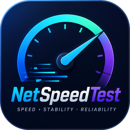
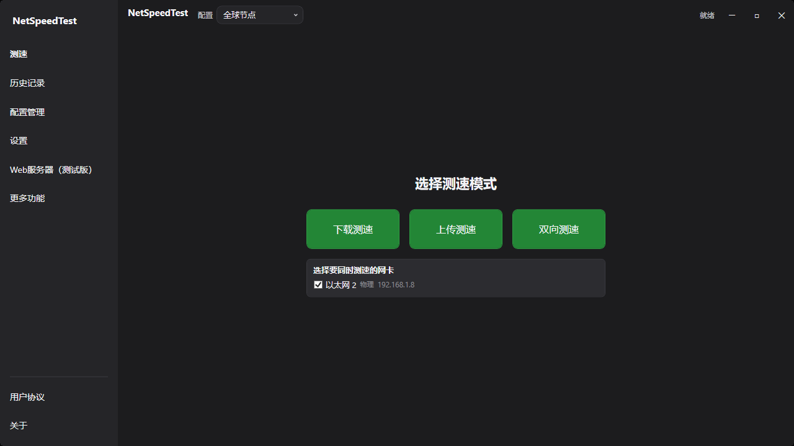
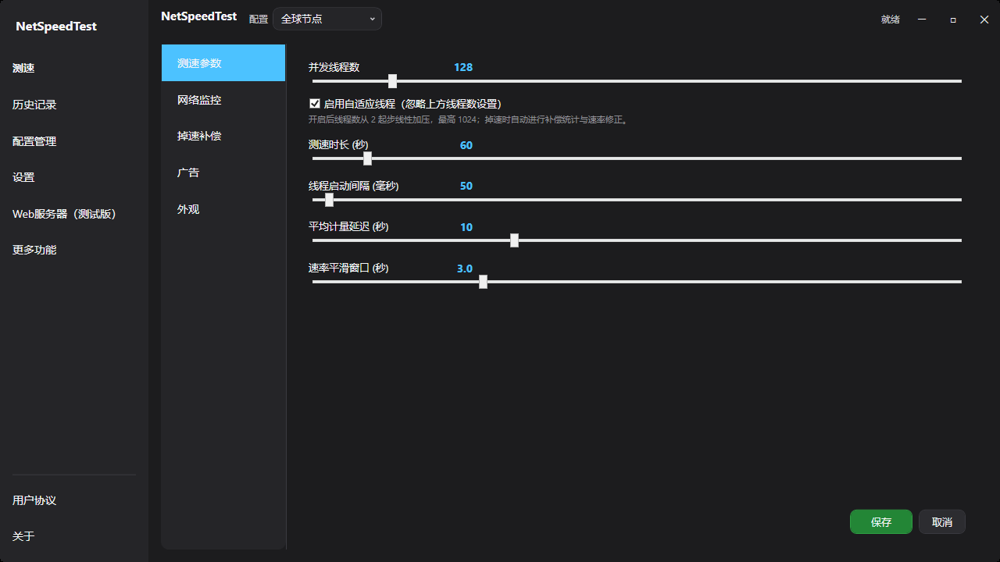

<div align="center">



**中文** · [English](README.en.md)

# 🚀 NetSpeedTest

**Windows 桌面端网络测速工具 · 专业级 · 开源免费**

[](https://github.com/lingyingaojue/NetSpeedTest/releases)
[](LICENSE)
[](https://github.com/lingyingaojue/NetSpeedTest)
[](https://dotnet.microsoft.com)
[](https://github.com/lingyingaojue/NetSpeedTest/releases)
[](https://github.com/lingyingaojue/NetSpeedTest/stargazers)
[](https://www.deepseek.com)

[下载](#-下载) · [官网](https://lingyingaojue.github.io/NetSpeedTest/) · [工具箱](#-网络工具箱) · [更新日志](#-更新日志)

</div>



> 暗色主题下的完整主界面：左侧内嵌页导航、自绘标题栏与实时速率曲线。

## 📖 目录

- [✨ 核心特性](#-核心特性)
- [🖼️ 界面预览](#️-界面预览)
- [🌐 Web 控制台与 REST API](#-web-控制台与-rest-api)
- [🧰 网络工具箱](#-网络工具箱)
- [⌨️ 快捷键与参数](#️-快捷键与参数)
- [🗂️ 数据与配置文件](#️-数据与配置文件)
- [🏗️ 技术架构](#️-技术架构)
- [🚀 快速开始](#-快速开始)
- [📥 下载](#-下载)
- [📝 更新日志](#-更新日志)
- [❓ 常见问题](#-常见问题)
- [🤝 参与贡献](#-参与贡献)
- [🤖 开发方式与 AI 协作](#-开发方式与-ai-协作)
- [💬 反馈与联系](#-反馈与联系)
- [📄 许可证](#-许可证)

## ✨ 核心特性

### 智能测速引擎

- **128 线程并发 HTTP GET / POST**，自适应模式最高 1024
- **URL 轮转调度 + 健康度评分**，失败节点自动冷却降权
- **掉速紧急补偿**：自动加线程并修正结果
- **跳过爬坡取均值 + 3 秒滑动窗口去毛刺**
- **渐变启动**，避免瞬间占满带宽

### 多网卡并行测速

- **勾选多张网卡同时测速**，各自绑定源 IP
- **默认优先选中带默认网关的网卡**
- **下载 / 上传曲线支持「合计 / 单网卡」切换**
- **单卡失败不影响其余网卡出结果**
- **虚拟网卡默认过滤**，可在设置中放行

### 全链路延迟探测

- **五层回退**：UDP → ICMP → TCP 443 → HTTPS HEAD → HTTP HEAD
- **外网延迟、抖动、内网延迟共用同一探测链路**
- **抖动按滑动窗口标准差实时平滑**
- **丢包率 5 包 / 批轮询**，首轮全失败自动 UDP 复核
- **每张网卡独立呈现延迟、抖动与丢包率**

### NIC 级精准计量

- **基于 IPv4Statistics 差分计算**，排除 HTTP 协议开销
- **Kbps / Mbps / Gbps 自动切换**
- **LiveCharts2 双折线图**，200 ms 采样、500 点滑动窗口
- **每网卡 9 项详情信息卡 + 活跃线程计数**
- **下载 / 上传图表可拖拽分割线**，模式切换带过渡动画

### 专业交互体验

- **自绘标题栏 + 侧边栏内嵌页**，测速中禁用页面切换
- **深 / 浅主题与中英双语即时切换并持久化**
- **系统托盘驻留**、状态联动与气泡通知
- **GitHub OTA 在线升级**，启动自动检查
- **快捷键** Enter / Esc / Ctrl+D / Ctrl+U / Ctrl+B

### 历史与配置管理

- **SQLite 持久化历史**，分页、统计栏与 CSV 导出
- **8 个内置 CDN 节点**，自定义配置导入 / 导出（兼容 HBCS）
- **设置原子写入**，异常中断不丢配置
- **内置 Web 服务器 + REST API 远程控制**
- **多网卡导出**包含聚合结果、每卡明细与 BatchId

## 🖼️ 界面预览



> 设置页：并发线程、测速时长与补偿参数逐项可调；浅色主题、内嵌页与 Web 控制台沿用同一套设计语言。

- 深色 / 浅色主题即时切换并持久化，配色与官网同源
- 历史、配置、设置、Web 服务器、更多、协议、关于均为侧边栏内嵌页
- Web 控制台适配桌面与手机浏览器，实时查看速率曲线与历史记录

## 🌐 Web 控制台与 REST API

内置 HTTP 服务器（默认开启，`HttpListener` 实现，无需额外安装运行时组件），手机或同网段电脑用浏览器即可远程查看与控制测速。

| 能力 | 说明 |
|:--|:--|
| 🖥️ **Web 控制台** | 访问 `http://<本机IP>:8080` 实时查看速率曲线、网卡状态与历史记录 |
| 🔀 **端口自动避让** | 默认端口被占用时自动顺延探测可用端口，实际端口持久化并在界面回显 |
| ⚙️ **自定义端口** | 支持在 Web 服务器页指定固定端口（1024 – 65535） |
| 🔐 **会话令牌** | 非回环写操作必须携带启动时随机生成的 `X-NST-Token`（256 位），回环访问免令牌 |
| 🛡️ **同网段访问控制（ACL）** | 按本机网卡网段生成访问清单，仅允许同网段设备访问，其他来源返回 403 |
| 🔒 **安全响应头** | 全量响应附带 `X-Content-Type-Options: nosniff`、`X-Frame-Options: DENY` 与 `Referrer-Policy: no-referrer` |
| 🚫 **SSRF 防护** | 关闭自动重定向并逐跳校验（最多 3 跳），拦截回环 / 私网 / 保留网段 / CGNAT / 组播 / IPv6 私有地址，目标端口限定 80 / 443 |
| 📄 **可改页面** | 页面位于 exe 同目录 `wwwroot\index.html`，可直接修改无需重新编译，发布版内嵌兜底副本 |

### REST API

| 方法 | 路径 | 说明 |
|:--|:--|:--|
| `GET` | `/api/status` | 测速状态、实时速率与当前端口 |
| `GET` | `/api/adapters` | 网卡列表与选中状态 |
| `POST` | `/api/adapters/select` | 切换参与测速的网卡 |
| `GET` | `/api/profiles` | 读取测速配置列表 |
| `POST` | `/api/profiles` | 新增或保存测速配置 |
| `GET` | `/api/history` | 分页读取历史记录（`?page=&pageSize=`） |
| `DELETE` | `/api/history` | 清除历史记录 |
| `GET` | `/api/settings` | 读取当前测速参数 |
| `POST` | `/api/settings` | 写入测速参数（并发写安全、原子落盘） |
| `POST` | `/api/test/start` | 开始测速（进入运行态后才返回 200，重复调用返回 409） |
| `POST` | `/api/test/stop` | 停止测速（准备阶段同样可取消） |
| `GET` | `/api/server` | 服务器端口、局域网状态与网卡网段绑定 |

> 所有接口对 UI 线程等待统一带 **2 秒超时**（超时返回 503 而不是一直挂起），单请求另带 30 秒请求级超时；错误信息对外脱敏，请求体上限 256 KB。

## 🧰 网络工具箱

内置 **18 种专业网络诊断工具**，一个窗口覆盖日常排查——程序里的 <b>18 合 1 工具箱</b>。

| 工具 | 说明 |
|:--|:--|
| 🏓 **Ping** | ICMP 连通性测试，自定义目标与次数，输出逐包 RTT 与 TTL |
| 🌐 **DNS 查询** | 域名 A / AAAA 地址解析，含耗时与地址族 |
| 📡 **HTTP 请求** | HEAD 请求探测，输出状态码 / 响应时间 / Server / Content-Type / Content-Length |
| 🗺️ **路由追踪** | ICMP TTL 逐跳追踪（最多 30 跳），实时显示跳点 IP / 延迟 / TTL |
| 🔌 **端口测试** | TCP 端口连通性测试，自定义主机与端口（1 – 65535） |
| 📏 **MTU 探测** | 二分法路径 MTU 探测（68 – 1500，禁止分片） |
| 🔄 **DNS 对比** | 8.8.8.8 / 114.114.114.114 / 1.1.1.1 / 223.5.5.5 四路延迟横向对比 |
| 🌍 **IP 归属** | IP 地理位置 / 运营商 / AS / 时区查询 |
| 🌐 **公网 IP** | ipify / ipip / ifconfig.me 三源探测出口 IP，交叉验证减少 CDN 干扰 |
| 🔒 **SSL 证书** | 证书颁发者 / 主题 / 生效与到期时间 / 剩余天数 / 序列号 / 签名算法 |
| 📨 **HTTP Header** | 任意 URL 响应头完整查看 |
| 🧮 **子网计算** | IP + 掩码 → 网络地址 / 广播地址 / 可用主机数与范围（含 /31、/32） |
| 📊 **带宽换算** | Mbps ↔ MB/s · KB/s · Gbps · KBps，并估算 100 MB 文件耗时 |
| 🕐 **时间戳** | Unix 秒级 / 毫秒级时间戳 ↔ 日期双向转换 |
| #️⃣ **文本哈希** | MD5 / SHA1 / SHA256 计算 |
| 🔤 **Base64** | Base64 编解码 |
| 🆔 **UUID 生成** | UUID v4 批量生成（1 – 50 个） |
| 🔍 **NAT 检测** | STUN（RFC 5389）判定映射行为（锥形 / 对称）、端口保留、Hairpin 自返与 STUN/TCP 可用性；Google + 小米双服务器，并与 HTTP 出口 IP 交叉验证 |

## ⌨️ 快捷键与参数

### 快捷键

| 快捷键 | 功能 |
|:--|:--|
| <kbd>Enter</kbd> | 开始测速（下载模式，等同 <kbd>Ctrl</kbd>+<kbd>D</kbd>） |
| <kbd>Esc</kbd> | 停止测速 |
| <kbd>Ctrl</kbd> + <kbd>D</kbd> | 仅下载 |
| <kbd>Ctrl</kbd> + <kbd>U</kbd> | 仅上传 |
| <kbd>Ctrl</kbd> + <kbd>B</kbd> | 全速双向 |

> 在文本框内输入时不会误触发。

### 可调参数

「范围」为设置页滑块的可调区间，「默认」为内置 `appsettings.json` 的出厂值。

| 参数 | 范围 | 默认 |
|:--|:--:|:--:|
| 并发线程数 | 2 – 1024 | **128** |
| 测速时长 | 10 – 600 s | **60 s** |
| 线程启动间隔 | 0 – 2000 ms | **50 ms** |
| 平均计量延迟 | 1 – 30 s | **10 s** |
| 速率平滑窗口 | 0.5 – 10 s | **3.0 s** |
| 网卡轮询间隔 | 200 – 5000 ms | **1000 ms** |
| 延迟轮询间隔 | 500 – 10000 ms | **1000 ms** |
| 抖动采样间隔 | 500 – 5000 ms | **1000 ms** |
| 抖动探测主机 | — | **8.8.8.8** |
| 丢包率监测地址 | — | **8.8.8.8** |
| 丢包率轮询间隔 | 500 – 5000 ms | **1000 ms** |
| 补偿阈值 | 0.3 – 0.8 | **0.5** |
| 确认时长 | 1 – 10 s | **3 s** |
| 自适应起始线程数 | 1 – 自适应上限 | **2** |
| 自适应线程上限 *(派生)* | 128 / 256 / 512 / 1024 阶梯 | **1024** |
| Web 服务器端口 | 1024 – 65535 | **8080** |

> **自适应线程上限**由引擎派生：单网卡为 1024，多网卡按网卡份额折算；开启自适应后「并发线程数」不生效，线程从起始线程数按 128 / 256 / 512 / 1024 阶梯扩容。<br>
> **Web 服务器端口**在「Web 服务器」页设置（自动避让或自定义），其余参数在「设置」页调整。<br>
> 导入的自定义配置 URL 会经过与 Web API 相同的 SSRF 校验。

## 🗂️ 数据与配置文件

全部用户数据位于 `%LOCALAPPDATA%\NetSpeedTest\`：

| 文件 | 说明 |
|:--|:--|
| `NetSpeedTest.db` | SQLite 数据库：测速历史与自定义配置（WAL 模式 + busy_timeout） |
| `appsettings.json` | 设置页保存的参数覆盖层（原子写入） |
| `web.json` | Web 服务器开关、端口模式与局域网访问设置 |
| `theme.json` / `language.json` | 主题与界面语言选择 |

> 程序内嵌一份默认 `appsettings.json`，与用户覆盖层合并生效，删除用户目录即恢复出厂设置。<br>
> 以 `--debug` 启动参数运行，可在 exe 同级目录生成 `debug.log` 日志。

## 🏗️ 技术架构

| 层级 | 技术 |
|:--|:--|
| 运行时 | .NET 8.0-windows |
| UI 框架 | WPF（自绘标题栏 + 侧边栏内嵌页） |
| 架构模式 | MVVM（CommunityToolkit.Mvvm 源生成器 + Microsoft.Extensions.DependencyInjection） |
| 实时图表 | LiveChartsCore.SkiaSharpView.WPF |
| 数据持久化 | Microsoft.Data.Sqlite |
| 配置系统 | Microsoft.Extensions.Configuration（内嵌默认值 + 用户覆盖层） |
| Web 服务器 | `System.Net.HttpListener` + 内嵌 `wwwroot` 静态资源 |
| 测试框架 | xUnit（`NetSpeedTest.Tests`） |
| AI 协作 | **DeepSeek**（AI 辅助编程） |

项目结构：

```text
NetSpeedTest/
├─ NetSpeedTest/            # WPF 主程序
│  ├─ Converters/           # XAML 值转换器
│  ├─ Helpers/              # 版本、格式化等通用辅助
│  ├─ Languages/            # 中 / 英文本地化资源
│  ├─ Models/               # 数据模型与选项
│  ├─ Services/             # 测速、Web 服务器、持久化等服务
│  ├─ Themes/               # 深 / 浅主题资源
│  ├─ ViewModels/           # MVVM 视图模型
│  ├─ Views/                # 窗口与内嵌页面
│  └─ wwwroot/              # Web 控制台静态资源
├─ NetSpeedTest.Tests/      # xUnit 测试（含 README 与站点契约测试）
├─ assets/                  # 图标、截图与官网资源
├─ docs/                    # 设计规范与 QA 文档
└─ tools/                   # 截图、文档校验与冒烟脚本
```

## 🚀 快速开始

### 环境要求

Windows 10 / 11 · [.NET 8 SDK](https://dotnet.microsoft.com/download/dotnet/8.0)

### 构建与运行

```powershell
git clone https://github.com/lingyingaojue/NetSpeedTest.git
cd NetSpeedTest
dotnet restore
dotnet build
dotnet run --project NetSpeedTest\NetSpeedTest.csproj
```

### 运行测试

```powershell
dotnet test NetSpeedTest.Tests\NetSpeedTest.Tests.csproj
```

### 发布单文件版

```powershell
dotnet publish NetSpeedTest\NetSpeedTest.csproj -c Release -r win-x64 --self-contained true `
  -p:PublishSingleFile=true -p:IncludeNativeLibrariesForSelfExtract=true
```

产物为单个自包含 exe（约 170 MB），目标机器无需预装 .NET 运行时。

### 端到端脚本

`tools\` 下提供针对真实 Release 构建的联调脚本（需要管理员权限以放行 HTTP.sys 端口）：

| 脚本 | 用途 |
|:--|:--|
| `tools\smoke-test.ps1` | 驱动 Web API：令牌校验、安全响应头、输入校验、测速生命周期、并发设置写入与日志 FATAL 扫描 |
| `tools\verify-version.ps1` | 校验版本号贯穿 csproj → exe 文件属性 → Web 控制台 → 静态资源 |
| `tools\verify-token.ps1` | 校验会话令牌在真实局域网 HTTP 请求下的强制生效 |
| `tools\verify-extra.ps1` | 补充场景验证 |
| `tools\verify-docs.ps1` | 校验 README 中英、官网页面与社区文件的模板一致性 |
| `tools\capture-screenshots.ps1` | 启动真实程序，按统一尺寸重拍 README / 官网截图 |

## 📥 下载

从 [Releases](https://github.com/lingyingaojue/NetSpeedTest/releases) 下载已编译的单文件版本（.NET 8 自包含发布，约 170 MB），开箱即用。

官网与在线体验：<https://lingyingaojue.github.io/NetSpeedTest/>

## 📝 更新日志

最近三个版本的变更记录见 [CHANGELOG.md](CHANGELOG.md)。当前版本 **v1.4.4** 集中修复 9 项缺陷：远程测速结果不落库、双向测速误报「0 成功」、中途停止记录流量为 0、MTU 跨网关探测失败、设置边界不一致、防火墙入站规则只删不建等；程序默认请求管理员权限（每次启动弹 UAC）以自动放行防火墙入站规则。

## ❓ 常见问题

### 测速结果和浏览器测速差距大怎么办？

浏览器测速多为单连接或少量连接的短时采样，NetSpeedTest 默认 128 线程并发压测并跳过爬坡段取均值，更接近链路真实带宽。若差距明显，请确认网络空闲、更换节点并 30 秒后复测。

### 为什么每次启动都会弹出 UAC？

v1.4.4 起程序清单请求管理员权限，用于自动创建 / 清理防火墙入站规则。标准账户拒绝提权时将无法启动，可在系统策略中允许该程序提权。

### 手机或同网段电脑打不开 Web 控制台？

确认访问地址是本机局域网 IP 与界面回显的实际端口（默认 8080，被占用时自动顺延）；ACL 仅放行同网段设备，跨网段与匿名来源会收到 403。

### 测速历史保存在哪里，如何备份？

历史与配置保存在 `%LOCALAPPDATA%\NetSpeedTest\`，其中 `NetSpeedTest.db` 为 SQLite 数据库；可直接复制整个目录备份，或在历史页导出 CSV。

### 支持哪些 Windows 版本，需要预装 .NET 吗？

支持 Windows 10 / 11 x64。下载的 Release 为 .NET 8 自包含单文件发布，目标机器无需安装 .NET 运行时；自行构建则需要 .NET 8 SDK。

## 🤝 参与贡献

欢迎贡献代码、文档与翻译，提交前请先阅读 [CONTRIBUTING.md](CONTRIBUTING.md)。

仓库的色板、章节模板与文案规范见 [docs/DESIGN.md](docs/DESIGN.md)。

- 功能建议与缺陷反馈请使用 [Issues](https://github.com/lingyingaojue/NetSpeedTest/issues)
- 安全问题请按 [SECURITY.md](SECURITY.md) 私下报告，不要公开提交 Issue
- 参与社区与讨论请遵守 [CODE_OF_CONDUCT.md](CODE_OF_CONDUCT.md)

## 🤖 开发方式与 AI 协作

**本项目使用 DeepSeek AI 制作。** 由 **凌影傲爵** 主导需求设计、架构决策与最终验收，**DeepSeek AI** 协作完成实现与文档。

| 角色 | 署名 |
|:--|:--|
| 设计与开发 | 凌影傲爵 |
| AI 协作 | DeepSeek |

> 该署名与程序内「关于 → AI 协作」卡片、[官网](https://lingyingaojue.github.io/NetSpeedTest/)页面保持一致。

## 💬 反馈与联系

| 渠道 | 地址 |
|:--|:--|
| 🐛 Issue | <https://github.com/lingyingaojue/NetSpeedTest/issues> |
| 📧 邮箱 | mashuo2010az@163.com |
| 💬 微信 / QQ | Smailboy2010 |
| 👥 QQ 交流群 | 见[官网「反馈与联系」](https://lingyingaojue.github.io/NetSpeedTest/#contact)二维码 |

> 应用内「关于」页的联系方式支持一键复制到剪贴板。

## 📄 许可证

[MIT License](LICENSE) · © 2026 lingyingaojue

<div align="center">

**NetSpeedTest** · © 2026 凌影傲爵 · 使用 DeepSeek AI 协作开发

</div>
